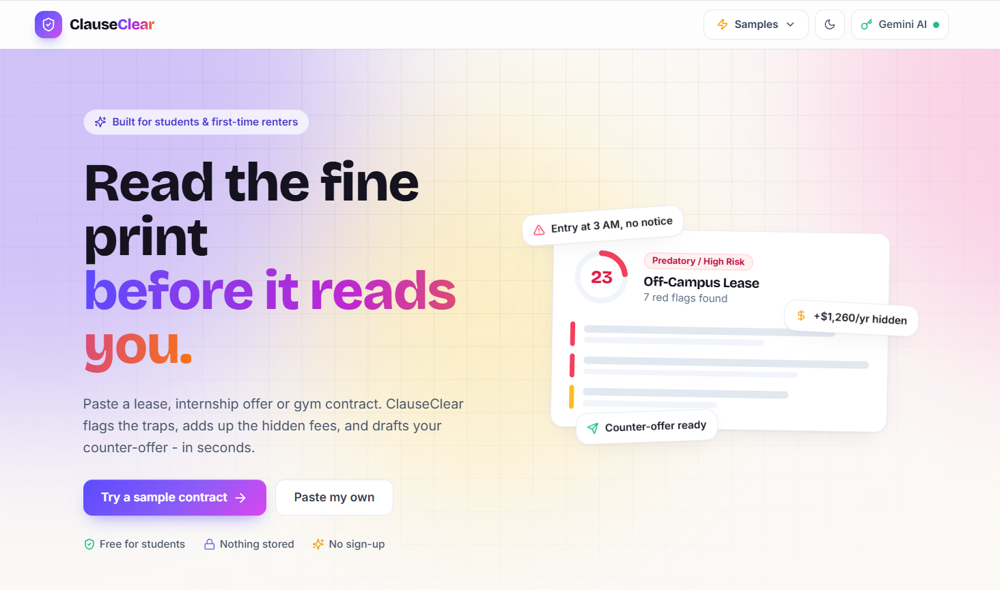
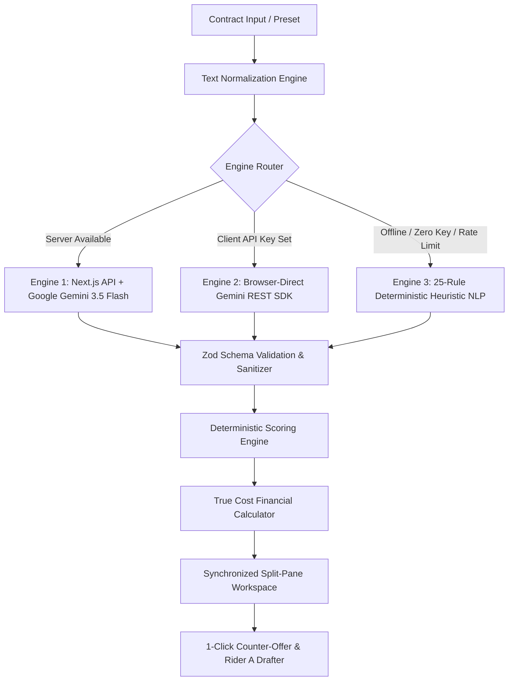

<div align="center">

# 🛡️ ClauseClear

### **The Open-Source AI Contract Auditing & Financial Transparency Engine for Students & First-Time Renters**

*“Read the fine print before it reads you.”*

Built with passion for **NextSpark Hacks 2026** 🏆

---

[](https://shaunjee.github.io/ClauseClear/)
[](./ClauseClear_Demo.mp4)
[](https://shaunjee.github.io/ClauseClear/)
[](https://nextjs.org/)
[](https://www.typescriptlang.org/)
[](https://ai.google.dev/)
[](https://shaunjee.github.io/ClauseClear/)
[](https://shaunjee.github.io/ClauseClear/)
[](./LICENSE)

<br />

**[🌐 Try the Live Website](https://shaunjee.github.io/ClauseClear/)** • **[🎬 Watch Demo Video](./ClauseClear_Demo.mp4)** • **[⚡ 1-Click Judge Presets](#-zero-setup-1-click-judge-presets)** • **[🏗️ Tri-Engine Architecture](#️-resilient-tri-engine-architecture)** • **[🚀 Quickstart](#-quickstart--local-development)**

<br />

<!-- Hero Poster -->
<a href="https://shaunjee.github.io/ClauseClear/">
  
</a>

<p align="center">
  <em>👆 Click the poster above to test the live application directly in your browser with zero setup.</em>
</p>

</div>

---

## 🎬 3-Minute Demo Video Walkthrough

Watch the complete, uncensored **3-minute walkthrough** demonstrating ClauseClear in action—from instant preset audit to bi-directional sync, True Cost financial simulation, and 1-click binding legal rider generation:

<div align="center">

<video src="ClauseClear_Demo.mp4" controls="controls" width="100%" poster="Poster.png">
  Your browser does not support the video tag. You can view or download the video directly via the link below.
</video>

<p align="center">
  ▶️ <strong><a href="ClauseClear_Demo.mp4">Click here to download or watch ClauseClear_Demo.mp4 (Full 1080p 60fps)</a></strong>
</p>

</div>

---

## 💡 The Problem: The Student Trap

Every semester, **millions of university students, young graduates, and first-time renters** sign 15-page legal agreements without understanding the fine print. Landlords and predatory corporations deliberately bury extreme legal traps:

* 🚪 **Unannounced 3:00 AM Entry:** Landlords claiming unrestricted rights to walk into apartments without prior notice.
* 💸 **Buried Monthly Junk Fees:** Mandatory doorstep trash valet ($35/mo), digital portal convenience fees ($45/mo), and pest fees ($25/mo) adding **+$1,260 to +$1,610/year** on top of advertised rent.
* 🔧 **Burdensome Repair Deductibles:** Forcing student tenants to pay the first $350 of plumbing or appliance repairs regardless of causation or normal wear-and-tear.
* 💻 **IP Seizure in "Unpaid Internships":** Accelerator and internship agreements seizing full ownership over students' personal side-projects, hackathon repos, and university capstones.
* 🔄 **90-Day Certified Mail Renewal Traps:** Obscure clauses locking students into another full year with automatic 15% rent spikes.

### Why Existing Solutions Fail

| Solution | Cost | Speed | Privacy | Actionable Leverage |
| :--- | :---: | :---: | :---: | :---: |
| **Tenant Attorneys** | $300 – $500 / hr | 3–7 business days | High | High (but unaffordable for students) |
| **Generic Chatbots (ChatGPT)** | Free / $20 / mo | ~15 seconds | ❌ Data used for training | ❌ Vague summaries, misses buried fee math, hallucinated citations |
| **🛡️ ClauseClear** | **100% Free** | **Instant (< 1s)** | **🔒 100% In-Memory / Zero Data Retained** | **✅ Mathematical 0-100 Score, Exact Verbatim Highlights, Grocery Conversion & Binding Rider A** |

---

## ⚡ Key Product Capabilities

### 1. 🎯 Deterministic Fairness Score (0 to 100)
ClauseClear rejects fuzzy, inconsistent AI scoring in favor of a **deterministic mathematical rubric**:
* **Base 100 points** with explicit deductions:
  * `-18 points` per critical legal violation (illegal entry, habitability waivers, IP seizure).
  * `-8 points` per moderate one-sided warning (repair deductibles, guest fines, late fee spikes).
  * `-4 points` per omitted statutory tenant protection.
* Animated cubic ease-out circular score gauge with dynamic color tokens (Rose Crimson `< 45`, Amber Caution `45–79`, Emerald Balanced `80+`).

### 2. 📑 Synchronized Split-Pane Bi-Directional Viewer
* **Verbatim Source Span Linking:** Every red flag links directly to the exact verbatim quote in the contract text.
* **Bi-Directional Interaction:**
  * Clicking **"Locate"** on any clause card auto-scrolls the contract and pulses the highlight.
  * Clicking any colored highlight in the contract auto-expands the corresponding card with **Plain-English Translation**, **Worst-Case Scenario**, and **Fairer Wording**.
* **Missing Protections Tab:** Identifies essential clauses omitted by the counterparty (e.g., 24-hour notice of entry, 21-day deposit return deadline, habitability rent abatement).

### 3. 💰 "True Cost" Financial Liability Simulator
* **Unbundled Transparency:** Separates advertised base rent from mandatory recurring junk fees (smart locks, valet trash, portal fees) and one-time move-in fees.
* **Student Grocery Conversion:** Translates annual hidden markups into concrete student metrics (e.g., *"$1,610 in hidden fees = 27 weeks of groceries"*).
* **Interactive "What If...?" Stress-Testing:** Toggle conditional traps (e.g., a $350 plumbing deductible or a $75 immediate late fee) to watch the 12-month liability bar dynamically expand in real time.

### 4. ✍️ 1-Click Attorney-Grade Counter-Offer Drafter & Rider A
* **Three Negotiation Tones:**
  * 🤝 **Collaborative (Recommended):** Friendly, respectful student tone framing adjustments as simple mutual clarifications.
  * ⚖️ **Firm:** Direct, assertive commercial tone requesting standard two-way commercial terms.
  * 📜 **Legal:** Formal statutory tone citing consumer-protection laws and municipal tenant codes.
* **Binding Schedule of Amendments (RIDER A):** Because emails aren't legally binding, ClauseClear automatically generates a formal contractual amendment addendum with superseded quotes, clean replacement terms, and signature blocks.
* **Celebratory Confetti:** One-click copy with instant confetti animation and pre-formatted `mailto:` email launch.

---

## 🏗️ Resilient Tri-Engine Architecture

ClauseClear is built around a **fail-safe Tri-Engine design** ensuring that contract audits succeed under any network condition, rate limit, or environment:



1. **Engine 1 (Server Gemini):** High-throughput server-side route powered by the Google Gemini API with structured JSON output and strict Zod validation.
2. **Engine 2 (Browser-Direct Gemini):** Client-side REST caller that communicates directly with Google Gemini using the user's custom API key (ideal for static deployments like GitHub Pages).
3. **Engine 3 (Local Heuristic NLP):** 100% offline, zero-latency regex & symbolic parser incorporating 25 legal pattern rules. Works with zero internet connection, zero API key, and 0ms latency.

---

## ⚡ Zero-Setup 1-Click Judge Presets

Judges can test ClauseClear instantly on the **[Live Demo Website](https://shaunjee.github.io/ClauseClear/)** with three pre-loaded real-world contracts:

```
┌─────────────────────────────────┬─────────────────────────────────┬─────────────────────────────────┐
│ 🏠 Oakwood Student Commons      │ 💼 NextGen Tech Contributor     │ 🏋️ Apex Fitness 24-Mo Club      │
├─────────────────────────────────┼─────────────────────────────────┼─────────────────────────────────┤
│ • Advertised: $950 / mo         │ • Unpaid 35-hr/week commitment  │ • Advertised: $39 / mo          │
│ • Actual: $1,055 / mo           │ • Seizes personal hackathons    │ • $89 annual facility fee       │
│ • 3:00 AM unannounced entry     │ • 2-year non-compete covenant   │ • 60-day certified mail cancel  │
│ • Score: 5 / 100 (Predatory)    │ • Score: 18 / 100 (High Risk)   │ • Score: 32 / 100 (Burdensome)  │
└─────────────────────────────────┴─────────────────────────────────┴─────────────────────────────────┘
```

---

## 🛠️ Tech Stack

| Layer | Technology | Key Highlights |
| :--- | :--- | :--- |
| **Frontend Framework** | **Next.js 14** (App Router) | Static export (`output: 'export'`), sub-second page loads |
| **Language** | **TypeScript 5.0+** | Strict types across schema, scoring, and store slices |
| **Styling & Design System** | **Tailwind CSS + Vanilla CSS Tokens** | Glassmorphism, aurora backdrops, dark/light mode toggle |
| **AI & LLM Reasoning** | **Google Gemini 3.5 Flash** | Contextual legal analysis, fee unbundling, negotiation letters |
| **Offline Engine** | **Symbolic Regex NLP** | 25 deterministic pattern heuristics, zero network overhead |
| **State Management** | **Zustand** (with `persist` middleware) | In-memory reactive store, cross-tab synchronization |
| **Validation** | **Zod** | Runtime schema safety for extracted clauses and financial items |
| **Iconography & Polish** | **Lucide Icons & Canvas-Confetti** | Micro-animations, responsive layout, confetti triggers |

---

## 🚀 Quickstart & Local Development

### Prerequisites
- Node.js 18.17+
- npm or pnpm

### 1. Clone & Install
```bash
git clone https://github.com/shaunjee/ClauseClear.git
cd ClauseClear
npm install
```

### 2. Launch Local Development Server
```bash
npm run dev
```
Open **[http://localhost:3000](http://localhost:3000)** in your browser. ClauseClear works immediately with all sample presets and the offline heuristic engine!

### 3. Add Google Gemini API Key (Optional)
To test live AI synthesis on arbitrary custom contracts:
* Click the **Gemini AI / Offline Mode** button in the navbar.
* Paste your Google Gemini API key (stored purely in your local browser `localStorage`).
* *Or* add it to `.env.local`:
  ```env
  GOOGLE_GENERATIVE_AI_API_KEY="your-gemini-api-key"
  ```

### 4. Build Static Production Bundle (GitHub Pages Ready)
```bash
npm run build
```
This compiles the entire application into pure static HTML, CSS, and JS inside the `out/` directory, ready to deploy to GitHub Pages or any static CDN.

---

## 🔒 Privacy, Security & Ethical AI

* 🛡️ **Zero Data Retention:** Custom contract text is processed purely in-memory and is never stored on a database, disk, or remote server.
* 🔑 **Client-Side Key Isolation:** User API keys remain in the client's browser `localStorage` and are transmitted directly to Google's API endpoints via HTTPS.
* ⚖️ **Educational Transparency Disclaimer:** ClauseClear is an educational transparency and consumer awareness tool designed to empower students. It does not constitute formal legal representation or attorney-client privileged counsel.

---

## 👥 Authors & Acknowledgments

* **Built for:** NextSpark Hacks 2026
* **Live Demo:** [https://shaunjee.github.io/ClauseClear/](https://shaunjee.github.io/ClauseClear/)
* **Repository:** [https://github.com/shaunjee/ClauseClear](https://github.com/shaunjee/ClauseClear)
* **License:** [MIT License](./LICENSE)

<div align="center">
  <br />
  <strong>ClauseClear: Empowering students to sign with confidence.</strong>
  <br />
  <sub>Made with ❤️ for students, renters, and builders everywhere.</sub>
</div>
